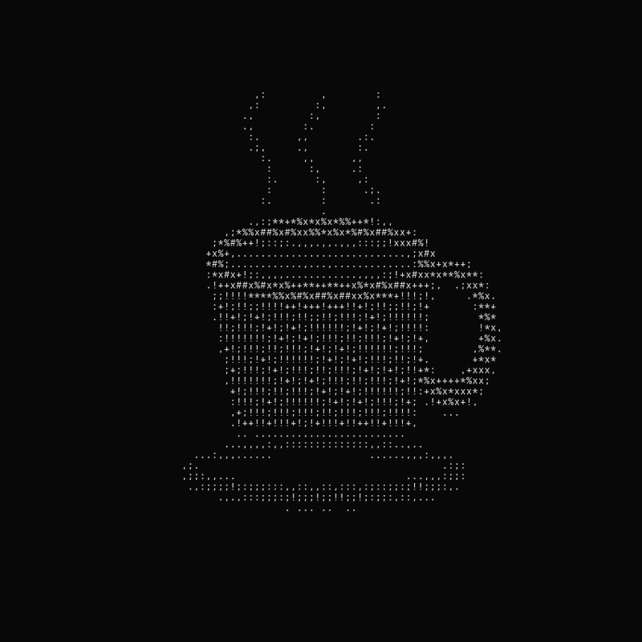
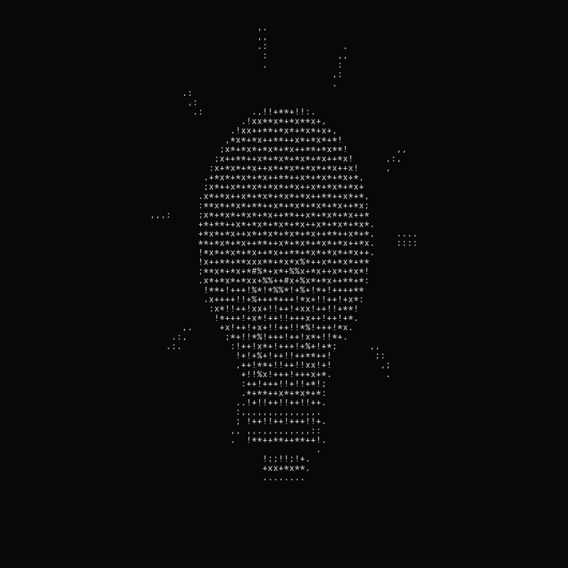
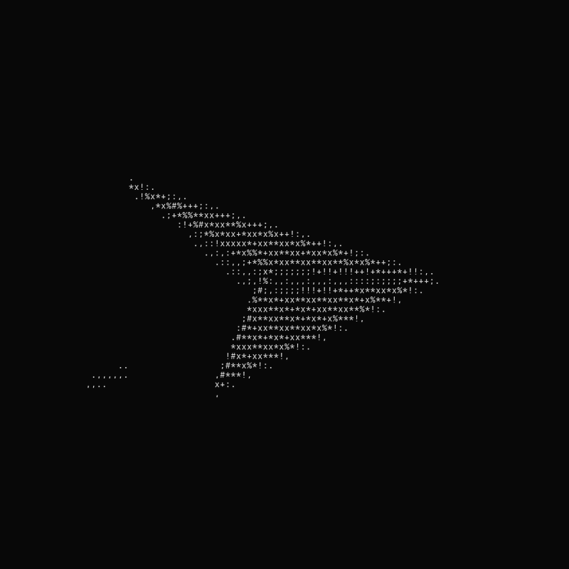

# ASCII Morph GIF

Turn a coffee cup into a galaxy, a light bulb into a jellyfish, or a paper plane into a bird. All made of characters.

A Codex skill and a standalone Python renderer. **The GIF contains only the artwork: no captions, branding, URLs or watermarks.**

[中文](#中文) · [日本語](#日本語)



## Install in Codex

Tell Codex:

> Use $skill-installer to install the skill at https://github.com/LIghtJUNction/ascii-morph-gif/tree/main/skills/ascii-morph-gif

The installed skill is available on your next turn. Then ask:

> Use $ascii-morph-gif to make a black-background character GIF of a coffee cup turning into a galaxy. No titles, footer or watermark. Save it with an HTML preview.

The built-in themes also include `bulb-jellyfish` and `plane-bird`. For new subjects, ask for your own pair: the skill can use two monochrome masks or extend the procedural drawing code. A new subject requires making those shapes; the presets are not a general image model.

Manual installation (default Codex home, without overwriting an existing skill):

```sh
git clone https://github.com/LIghtJUNction/ascii-morph-gif.git
mkdir -p ~/.codex/skills
cp -R -n ascii-morph-gif/skills/ascii-morph-gif ~/.codex/skills/
```

If you set `CODEX_HOME`, use its `skills` directory instead.

## Run without Codex

Python 3.10+, a monospace TrueType font, Pillow and NumPy. No image-generation API, browser, ffmpeg or account required.

```sh
git clone https://github.com/LIghtJUNction/ascii-morph-gif.git
cd ascii-morph-gif
python3 -m venv .venv
.venv/bin/pip install -r skills/ascii-morph-gif/scripts/requirements.txt
.venv/bin/python skills/ascii-morph-gif/scripts/render.py \
  --preset coffee-galaxy --output output/coffee-galaxy.gif --html
```

On Windows, use `.venv\Scripts\python` and `.venv\Scripts\pip`. If font discovery fails, pass `--font /path/to/monospace.ttf` (Menlo, Consolas or DejaVu Sans Mono).

Default export: 800×800, 110 frames, 9.9 seconds, endless loop. Produces before/after PNGs and an optional offline HTML text player with pause and reduced-motion support. HTML uses JavaScript to change text frames; this is not a CSS-only animation.

```sh
# Another preset
.venv/bin/python skills/ascii-morph-gif/scripts/render.py \
  --preset bulb-jellyfish --output output/jellyfish.gif

# Your own white-on-black silhouettes
.venv/bin/python skills/ascii-morph-gif/scripts/render.py \
  --from-mask seed.png --to-mask tree.png --output output/seed-tree.gif
```

Options: `--size 800`, `--frames 110`, `--frame-ms 90`, `--font PATH`, `--foreground '#dddddd'`, `--background '#080808'`, `--seed 48`, `--html`. Frame duration must be a multiple of 10 ms. Custom masks preserve aspect ratio; alpha cuts out transparent pixels.

## More examples





## 中文

这是一个制作「黑底字符变形动图」的 Codex skill。GIF 里只留作品，不加标题、编号、网址、水印或尾注。

把这句话发给 Codex 安装：

> 使用 $skill-installer 安装 https://github.com/LIghtJUNction/ascii-morph-gif/tree/main/skills/ascii-morph-gif

下一轮即可使用：

> 用 $ascii-morph-gif 做一张咖啡杯变星系的字符 GIF，黑底，循环播放，不要标题和尾注，同时输出网页预览。

内置：咖啡杯→星系、灯泡→水母、纸飞机→飞鸟。也可以提供自己的黑底白色轮廓图，或让 Codex 添加新的程序化形状。技能负责生成素材；发布帖子需要单独授权。

## 日本語

黒い背景の文字が別の形に変わるGIFを作るCodexスキルです。GIFには作品だけを入れます。タイトル、URL、ロゴ、透かし、脚注は付けません。

Codexにインストールを頼む：

> $skill-installer で https://github.com/LIghtJUNction/ascii-morph-gif/tree/main/skills/ascii-morph-gif をインストールしてください。

次のターンから使えます：

> $ascii-morph-gif でコーヒーカップが銀河に変わる文字アートGIFを作って。黒背景、ループ再生。タイトルや透かしは不要。HTMLプレビューも出力して。

## License

MIT. See [LICENSE](LICENSE). The renderer makes shapes procedurally; no third-party animation is copied. Fonts are supplied by your system and are not redistributed here.
